  

### Hola, soy Mateo

Construyo aplicaciones web y convierto datos en decisiones.

- Estudiante de Ingeniería Informática en la **UMSS** · **Medalla de Oro 2026** al mejor promedio de la carrera
- Fui asistente de cátedra de **Introducción a la Programación** y **Teoría de Grafos** (2024–2025)
- Hice mi pasantía en **MAXAM FANEXA** y desarrollo sistemas full stack como freelance para negocios locales
- Me muevo entre el desarrollo web (React, Node.js, PostgreSQL) y el análisis de datos (Python, SQL, Power BI)
- Completé el curso **CCNA: Introducción a las Redes** de Cisco Networking Academy y tengo más de 1500 horas de formación certificada en desarrollo, datos e IA

### Stack

  

  
  
  
  
  

### Estadísticas

  
  

  

### Contribuciones en 3D

  

  

### Proyectos destacados

<table>
  <tr>
    <td width="50%" valign="top">
      <strong>Sistema de Control de Viáticos</strong> 
      Pasantía · MAXAM FANEXA  
      Viajes corporativos y rendición de gastos por rol, con extracción de comprobantes por IA y reportes en PDF y Excel.  
      <code>React</code> <code>Node.js</code> <code>Express</code> <code>Supabase</code> <code>Gemini</code>
    </td>
    <td width="50%" valign="top">
      <strong>Sistema Cafebar</strong> 
      Cliente freelance · Entregado  
      Ventas por mesa, cocina, inventario y reportes para un café temático. Tres versiones: escritorio en Python, web con Supabase y hoy escritorio con Electron.  
      <code>React</code> <code>Node.js</code> <code>PostgreSQL</code> <code>Electron</code> <code>PyQt</code>
    </td>
  </tr>
  <tr>
    <td width="50%" valign="top">
      <strong>Brasa Brava</strong> 
      Cliente freelance · En curso  
      Caja, cocina, catálogo, stock, mesas y promociones. El mismo código corre en la web y como app de escritorio.  
      <code>React</code> <code>Express</code> <code>PostgreSQL</code> <code>Vitest</code>
    </td>
    <td width="50%" valign="top">
      <strong><a href="https://github.com/ProcesosAgilesUMSS/sansistore">SansiStore</a></strong> 
      Procesos Ágiles · Proyecto en equipo  
      Tienda en línea de la comunidad UMSS hecha por varios equipos con Scrum. Aporté el carrito, el filtro por categorías y el aviso de stock por correo.  
      <code>Astro</code> <code>React</code> <code>TypeScript</code> <code>Firebase</code>
    </td>
  </tr>
  <tr>
    <td width="50%" valign="top">
      <strong>Prototipo HTR para código manuscrito</strong> 
      Proyecto de Grado  
      Transcribe el código Java y Python escrito a mano en exámenes con herramientas de reconocimiento de escritura.  
      <code>Python</code> <code>TrOCR</code> <code>PaddleOCR</code> <code>Tesseract</code>
    </td>
    <td width="50%" valign="top">
      <strong><a href="https://github.com/mateomerino14/CAPILLA-BLENDER">Capilla con bibliotecaria en 3D</a></strong> 
      Universidad · Modelado 3D  
      Escena modelada en Blender, con renders en Cycles y un visor en vivo en mi portafolio.  
      <code>Blender</code> <code>Three.js</code>
    </td>
  </tr>
</table>

  <a href="https://mateomerino14.github.io/PORTAFOLIO/#proyectos">Ver todos los proyectos en mi portafolio →</a>

### Contacto

  
  
  

